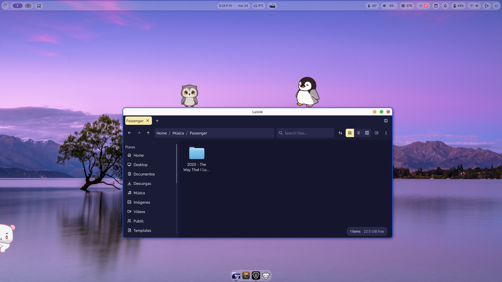

# UmbrielSupport para wl_shimeji

Plugin para [wl_shimeji](https://github.com/CluelessCatBurger/wl_shimeji) que
usa el socket IPC de [Umbriel](https://github.com/noctalia-dev/umbriel) para
decir a las mascotas dónde está la ventana activa y permitirles moverla.

Es el equivalente al plugin `kwinsupport`, pero para sesiones Umbriel. No depende
de D-Bus ni de KWin: toda la comunicación se hace con el socket UNIX JSON de
Umbriel.



## Qué hace

- Se suscribe a los eventos `windows` y `outputs` de Umbriel y mantiene un
  snapshot local con la geometría global de ventanas y monitores.
- Publica en wl_shimeji la ventana elegida como IE (*interactive element*)
  mediante `set_active_ie(...)`, que es lo que permite a las mascotas pararse,
  sentarse y caminar sobre una ventana:
  - ignora ventanas a pantalla completa, minimizadas, ocultas y sin tamaño;
  - la selección se controla con `UMBRIEL_IE_MODE` (ver más abajo).
- Avisa con `window_moved_hint()` cuando la ventana activa cambia o se mueve,
  para cancelar acciones de mascotas que estuvieran arrastrándola.
- Implementa los hooks opcionales:
  - `wl_shimeji_plugin_move`: envía `window-move-to` con ancla `top_left`,
    convirtiendo las coordenadas globales de wl_shimeji a coordenadas del área
    útil del monitor;
  - `wl_shimeji_plugin_restore`: vuelve a colocar en `(100, 100)` las ventanas
    flotantes que quedaron fuera de todos los monitores;
  - `wl_shimeji_plugin_activate`: envía `window-focus` para enfocar la ventana
    seleccionada.

La conexión es no bloqueante, se reconecta sola con retroceso exponencial
(1–30 s) y limpia el estado al perder el socket.

## Requisitos

- `wl_shimeji` con API de plugins `0.0.2` (cabeceras
  `wl_shimeji/plugins.h` y `master_header.h`, y
  `libwayland-shimeji-plugins.so`).
- `jansson` (parser JSON): en Debian/Ubuntu, `libjansson-dev`.
- `cc`, `make` y `pkg-config`.

En esta máquina las cabeceras y la librería están en `/usr/local/include` y
`/usr/local/lib`, que es lo que usa el `Makefile` por defecto (`PREFIX=/usr/local`).
Si tu instalación está en otro sitio:

```sh
make PREFIX=/usr WL_SHIMEJI_INCLUDEDIR=/usr/include WL_SHIMEJI_LIBDIR=/usr/lib
```

## Compilación, pruebas e instalación

```sh
cd wl_shimeji.umbriel
make          # genera build/plugins/libumbrielsupport.so
make test     # pruebas del parser + integración con un Umbriel simulado
make install  # instala en ~/.local/lib/wl_shimeji_umbriel/
```

`make install` copia la librería en `$(PLUGINS_DIR)`, que por defecto es
`~/.local/lib/wl_shimeji_umbriel/`. No hace falta `sudo`. Si prefieres instalar
en otro sitio, cambia `plugins_location` en
`~/.local/share/wl_shimeji/shimeji-overlayd.conf` para que apunte al directorio
elegido:

```sh
make PLUGINS_DIR=/usr/local/lib/wl_shimeji_umbriel install
```

También se puede compilar como subdirectorio de `wl_shimeji/src/plugins/`:

```sh
cp -r wl_shimeji.umbriel /ruta/a/wl_shimeji/src/plugins/umbriel
cd /ruta/a/wl_shimeji && make build-plugins && sudo make install-plugins
```

## Configuración

wl_shimeji carga automáticamente los `.so` de `/usr/lib/wl_shimeji/` (o del
directorio que indiques con `plugins_location` en `shimeji-overlayd.conf`).

### Ventana sobre la que caminan las mascotas

La ventana publicada como IE se elige con `UMBRIEL_IE_MODE`, que se lee al
cargar el plugin. Defínela en el entorno de `shimeji-overlayd` y reinicia el
overlay:

| Valor              | Ventana que se publica como IE                                       |
| ------------------ | -------------------------------------------------------------------- |
| `active` (default) | foco global (`active`), luego foco del workspace, luego única candidata |
| `focused`          | foco del workspace (`focused`) primero, luego foco global             |
| `largest`          | ventana elegible más grande (`w * h`); útil para maximizadas          |
| `none`             | ninguna: las mascotas no interactúan con ventanas                    |

Se aceptan alias: `seat` = `active`, `workspace` = `focused`,
`biggest`/`max` = `largest`, `off`/`disabled` = `none`. Un valor desconocido
produce un aviso y se usa `active`.

```sh
UMBRIEL_IE_MODE=largest shimeji-overlayd ...
```

También puede guardarse en `~/.config/wl_shimeji/umbriel-support.conf` (o
`$XDG_CONFIG_HOME/wl_shimeji/umbriel-support.conf`):

```ini
ie_mode=largest
```

La variable de entorno tiene prioridad sobre el archivo. Esta opción también
está en `wl-shimeji-gui` → *Ajustes* → *Interacción y comportamiento* →
«Mascotas sobre ventanas (UmbrielSupport)».

### Separación respecto al borde de la ventana

Umbriel informa del borde superior del marco. `ie_top_inset` desplaza el borde
superior de la IE hacia abajo (o hacia arriba si es negativo). El valor por
defecto es `5` px; con `0` los pies coinciden con el borde del **área de
contenido**, que queda ~30 px por debajo del borde visible (la barra de título).
Para que los pies toquen el borde visible usa `-30`.

```ini
# ~/.config/wl_shimeji/umbriel-support.conf
ie_mode=active
ie_top_inset=-30
```

También se puede usar `UMBRIEL_IE_TOP_INSET` en el entorno del daemon. El rango
válido es de `-64` a `64`; la variable de entorno tiene prioridad sobre el
archivo. `wl-shimeji-gui` conserva esta clave al guardar `ie_mode`.

Además, wl_shimeji necesita `ie_interactions=true` en
`shimeji-overlayd.conf`. En wl_shimeji 0.0.2 las acciones IE (`FallWithIe`,
`WalkWithIe`, `ThrowIe`) también comprueban `ie_throwing`: déjalo en `true` si
quieres que las mascotas lleguen a la ventana y se muevan por ella.

### Socket de Umbriel

El plugin elige el socket en este orden:

1. `UMBRIEL_SOCKET`, si está definido;
2. `$XDG_RUNTIME_DIR/umbriel-$WAYLAND_DISPLAY.sock`;
3. como último recurso, `/run/user/<uid>/umbriel-$WAYLAND_DISPLAY.sock`.

Debe ejecutarse dentro de una sesión Umbriel. En otras sesiones el plugin se
carga pero no recibe eventos.

### Depuración

```sh
# Ver los eventos que publica Umbriel
printf '{"cmd":"subscribe","events":["windows","outputs"]}\n' | socat - "$UMBRIEL_SOCKET"

# Llamar al plugin directamente con un cliente IPC
noctalia msg plugin <entry> <target> ...
```

## Herramientas para prototypes

`tools/shimeji-to-wlshm` convierte un `shimeji.zip` en un `.wlshm` de
wl_shimeji y, a continuación, aplica los fixes necesarios para que el
personaje funcione con wl_shimeji 0.0.2:

- **scale**: reescala los sprites y ajusta anclas/hotspots a 128 px.
- **anchor**: ajusta `image_anchor_y` al borde inferior visible del sprite.
- **fall**: pone a 0 la frecuencia de la conducta aleatoria `fall`, que si no
  hace que la mascota caiga periódicamente hasta salir de pantalla.
- **embedded**: envuelve en `Sequence` las acciones `Embedded`/`Move` que un
  behavior invoca directamente; en 0.0.2 esas acciones reciben
  `overwritten_locals = NULL` y provocan un SIGSEGV que cierra el overlay.
- **cover**: retira placeholders «No image» no referenciados y crea una
  carátula con el nombre del personaje para que el GUI la encuentre.

Los cinco fixes se ejecutan en memoria, en ese orden, antes de escribir el
archivo final. Son idempotentes: si no hay cambios, el `.wlshm` no se
reescribe. La validación (cabecera WLPK, JSON y QOI) se hace antes y después.

```sh
# Convertir y arreglar en un solo paso
tools/shimeji-to-wlshm ~/Descargas/shimeji.zip -o ~/Descargas/MiPersonaje.wlshm

# Convertir, arreglar e importar en wl_shimeji
tools/shimeji-to-wlshm ~/Descargas/shimeji.zip --import

# Volver a aplicar los fixes a un .wlshm ya convertido (sobrescribiéndolo)
tools/shimeji-to-wlshm MiPersonaje.wlshm --fix-only \
    -o MiPersonaje.wlshm -f
```

Opciones útiles: `--fixes scale,anchor,fall,embedded,cover` para elegir o
reordenar los fixes, `--no-fix` para desactivarlos, `--height N` para cambiar
la altura objetivo de `scale`, `-b` para elegir el prototype base y `--import`.
El modo `--fix-only` admite un `.wlshm` como entrada y por defecto escribe un
archivo `*.fixed.wlshm`.

Para las instancias Shimeji-EE reales (`conf/` + `img/`) se usa el convertidor
oficial `shimejictl convert`; para los bundles (`manifest.json` +
`animation.json` + `sprites/`) se reutiliza la lógica del prototype base
`Shimeji.Shimeji`, que debe estar instalado. El script necesita los módulos de
Python `Pillow` y `qoi` (instalados en `~/.local/lib/python3.13/site-packages`,
donde los busca el convertidor).

Hay una copia traducida al inglés con la misma funcionalidad:
`tools/shimeji-to-wlshm-en`.

Tras importar un `.wlshm` corregido, reinicia `shimeji-overlayd` para recargar
los prototypes y recarga la lista de `wl-shimeji-gui` para ver la carátula.

## Limitaciones

- El IPC de Umbriel no expone la posición global del puntero, así que el plugin
  no alimenta `set_cursor_pos_func`. Los comportamientos que siguen al cursor
  necesitan otra fuente.
- `window-move-to` solo funciona sobre ventanas flotantes. En layouts de
  mosaico (scrolling, dwindle, master), Umbriel rechaza el movimiento; las
  mascotas no pueden reordenar esas ventanas.
- Las ventanas sin identificador externo (`id` vacío) no pueden ser objetivo
  de acciones; sí se usan para calcular la ventana activa.

## Estructura

```
src/plugin.c    símbolos exportados y callbacks de wl_shimeji
src/ipc.c       cliente no bloqueante del socket de Umbriel
src/state.c     parseo de snapshots y selección de ventana
src/state.h     tipos y API del estado de Umbriel
tests/          pruebas del parser y cliente IPC simulado
tools/          convertidor de shimeji.zip con fixes integrados (ES/EN)
```

## Licencia

GPL-2.0-or-later, igual que wl_shimeji. Ver [LICENSE](LICENSE).
